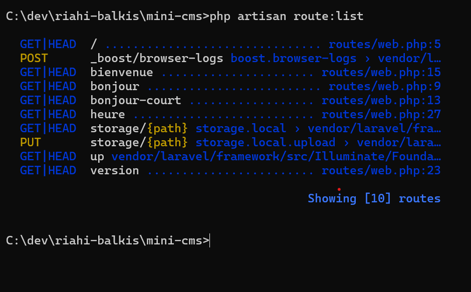
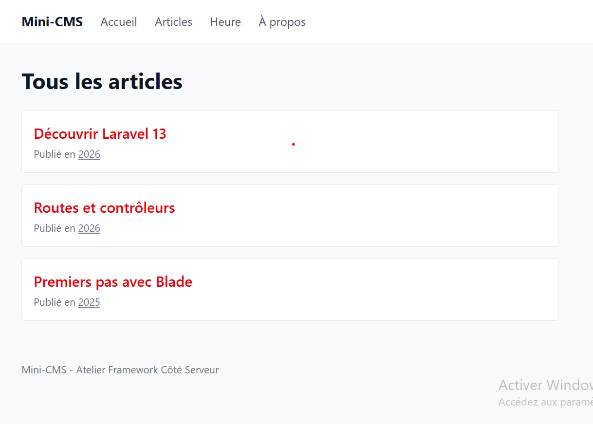
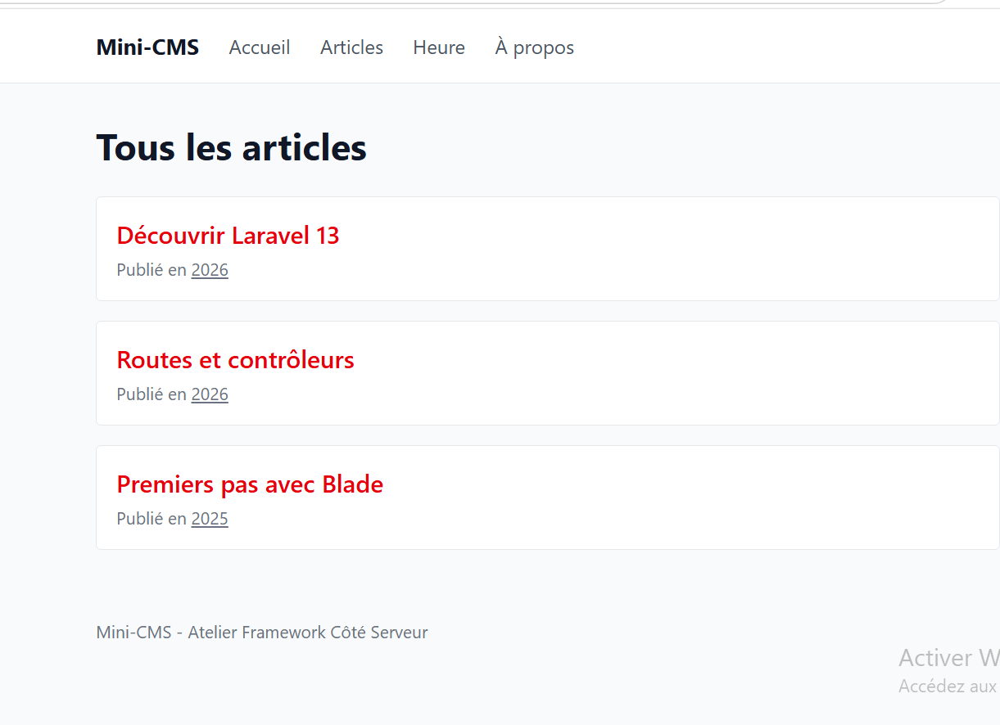
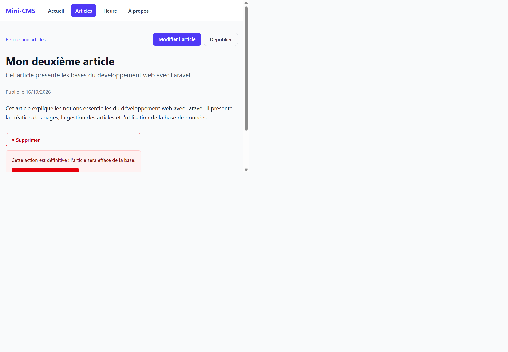
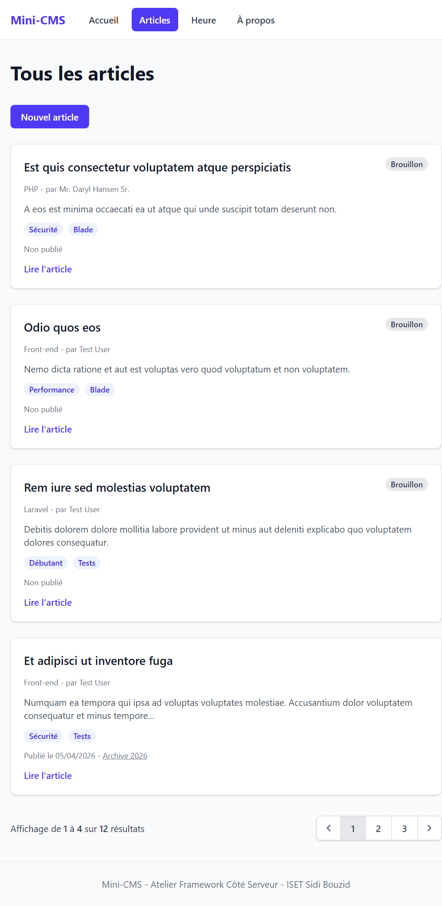
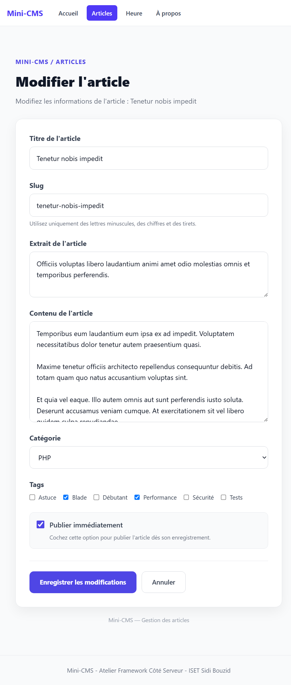
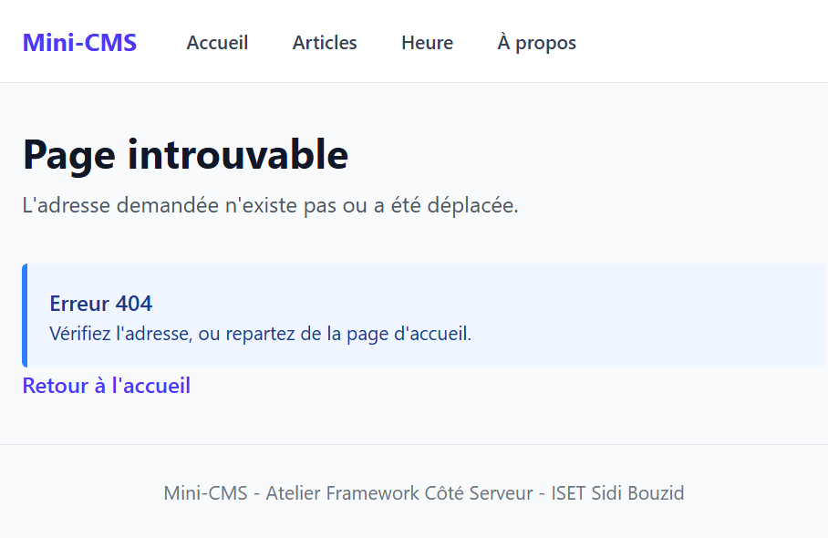
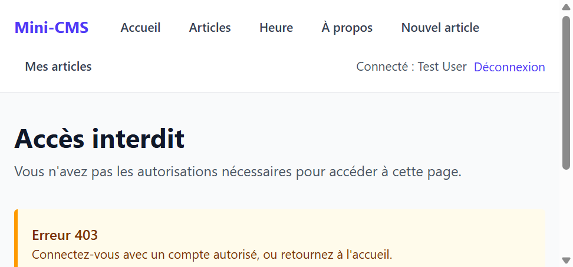
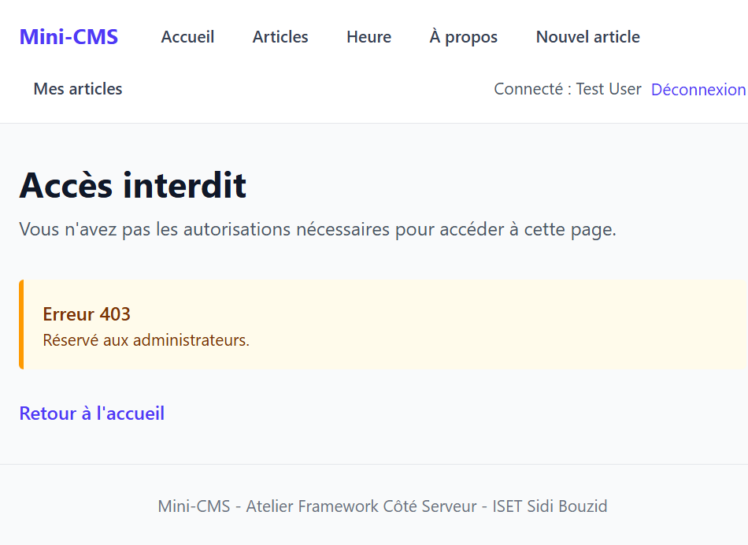

# Mini-CMS

Projet fil rouge de l'Atelier Framework Côté Serveur (Laravel 13, PHP 8.3+), 3e année MDW, ISET Sidi Bouzid.

Auteur : Balkis Riahi, groupe MDW33.

Mini-CMS évoluera au fil du semestre vers une petite plateforme de publication : pages publiques, back-office authentifié, API JSON et tests Pest. Chaque session se termine par un tag Git (`lab-01`, `lab-01b`, puis un tag par session).

## État actuel (tag lab-06b)

- Middleware `admin` (`App\Http\Middleware\EnsureUserIsAdmin`) sur tout `/admin` : un auteur reçoit 403 « Réservé aux administrateurs. ».
- Gate `manage-tags`, comme `manage-categories` : contrôleur, Form Requests et menu.
- Brouillons protégés : `PostPolicy::view` et le scope `visibleTo` ; un brouillon n'est visible que par son auteur et les administrateurs.
- Tests d'autorisation : `AdminAccessTest` (7 tests), `PostVisibilityTest` (5 tests) et `UserRoleTest` (2 tests), en plus des tests de la session 11.
- Comparaison écrite avec le starter kit Livewire (section ci-dessous).
- Défi facultatif : la page `/admin/utilisateurs` permet aux administrateurs de gérer les rôles sans modifier leur propre rôle.

## Données de démonstration

Après un clone, reconstruire la base avec `php artisan migrate:fresh --seed`. Attention : cette commande vide la base avant de la remplir.

## Routes disponibles

| Méthode | URI | Nom | Action |
|---|---|---|---|
| GET | `/` | `home` | `PageController@home` |
| GET | `/a-propos` | `about` | `PageController@about` |
| GET | `/heure` | `time` | `PageController@time` |
| GET | `/inscription` | `register` | `RegisterController@create` |
| POST | `/inscription` | - | `RegisterController@store` |
| GET | `/connexion` | `login` | `LoginController@create` |
| POST | `/connexion` | - | `LoginController@store` |
| POST | `/deconnexion` | `logout` | `LoginController@destroy` |
| GET | `/posts` | `posts.index` | `PostController@index` |
| GET | `/posts/archive/{year}` | `posts.archive` | `PostController@archive` |
| GET | `/posts/categorie/{category:slug}` | `posts.category` | `PostController@byCategory` |
| GET | `/posts/tag/{tag:slug}` | `posts.tag` | `PostController@byTag` |
| GET | `/posts/create` | `posts.create` | `PostController@create` |
| POST | `/posts` | `posts.store` | `PostController@store` |
| GET | `/posts/{post}` | `posts.show` | `PostController@show` |
| GET | `/posts/{post}/edit` | `posts.edit` | `PostController@edit` |
| PUT/PATCH | `/posts/{post}` | `posts.update` | `PostController@update` |
| DELETE | `/posts/{post}` | `posts.destroy` | `PostController@destroy` |
| PATCH | `/posts/{post}/publication` | `posts.publication` | `PostController@togglePublication` |
| GET | `/mes-articles` | `posts.mine` | `PostController@myPosts` |
| GET | `/admin/categories` | `admin.categories.index` | `CategoryController@index` |
| GET | `/admin/categories/create` | `admin.categories.create` | `CategoryController@create` |
| POST | `/admin/categories` | `admin.categories.store` | `CategoryController@store` |
| GET | `/admin/categories/{category}/edit` | `admin.categories.edit` | `CategoryController@edit` |
| PUT/PATCH | `/admin/categories/{category}` | `admin.categories.update` | `CategoryController@update` |
| DELETE | `/admin/categories/{category}` | `admin.categories.destroy` | `CategoryController@destroy` |
| GET | `/admin/tags` | `admin.tags.index` | `TagController@index` |
| GET | `/admin/tags/create` | `admin.tags.create` | `TagController@create` |
| POST | `/admin/tags` | `admin.tags.store` | `TagController@store` |
| GET | `/admin/tags/{tag}/edit` | `admin.tags.edit` | `TagController@edit` |
| PUT/PATCH | `/admin/tags/{tag}` | `admin.tags.update` | `TagController@update` |
| DELETE | `/admin/tags/{tag}` | `admin.tags.destroy` | `TagController@destroy` |
| GET | `/admin/utilisateurs` | `admin.users.index` | `UserRoleController@index` |
| PATCH | `/admin/utilisateurs/{user}/role` | `admin.users.role` | `UserRoleController@updateRole` |

Les articles publiés sont publics ; un brouillon n'est visible que par son auteur ou un administrateur. Les routes de création et de gestion des articles exigent une connexion. Toute la zone `/admin` est réservée aux administrateurs.

## Prérequis

- PHP et Composer
- Node.js LTS et npm
- Git

## Installation

### Bash (Git Bash, macOS, Linux)

```bash
git clone https://github.com/BALKIS1429/mini-cms.git
cd mini-cms
composer install
npm install
cp .env.example .env
php artisan key:generate
touch database/database.sqlite
php artisan migrate
composer run dev
```

### PowerShell (Windows)

```powershell
git clone https://github.com/BALKIS1429/mini-cms.git
cd mini-cms
composer install
npm install
copy .env.example .env
php artisan key:generate
New-Item database\database.sqlite -ItemType File
php artisan migrate
composer run dev
```

Ouvrir ensuite [http://localhost:8000](http://localhost:8000).

## Captures d'écran

### Page d'accueil


### Liste des routes



### Page À propos


### Accueil avec le layout


### Liste des articles — Session 03



### Détail d'un article



### Session 04


### Session 06




### Session 07




### Session 08




### Session 09


### Session 10

Back-office des catégories et des tags, messages de validation en français, pages 404 et 503 dans le layout du site.




### Session 11




### Session 12




## Comparaison avec le starter kit Livewire

| Fonction | Mini-CMS (authentification manuelle) | Starter kit Livewire |
|---|---|---|
| Routes d'authentification | `/inscription`, `/connexion` et `/deconnexion` sont déclarées dans `routes/web.php`. | Fortify enregistre les routes depuis son paquet ; elles ne sont pas déclarées dans `routes/web.php`. |
| Inscription | `RegisterController`, `RegisterRequest` et `Hash::make`. | `app/Actions/Fortify/CreateNewUser.php` valide puis crée l'utilisateur ; écran Livewire dans `resources/views/pages/auth/register.blade.php`. |
| Connexion | `LoginController::store` appelle `Auth::attempt`, puis régénère la session. | Contrôleur Fortify et `resources/views/pages/auth/login.blade.php`. |
| Déconnexion | `LoginController::destroy` appelle `Auth::logout`, `invalidate()` et `regenerateToken()`. | Route Fortify et `app/Livewire/Actions/Logout.php` effectuent ces opérations. |
| Limitation des tentatives | Aucune limitation n'est configurée dans Mini-CMS. | Cinq tentatives par minute et par e-mail/adresse IP via `FortifyServiceProvider`. |
| Mot de passe oublié | Non implémenté. | `Features::resetPasswords()` dans `config/fortify.php`. |
| Vérification de l'e-mail | Non implémentée. | `Features::emailVerification()`, `MustVerifyEmail` et le middleware `verified`. |
| Double authentification | Non implémentée. | `Features::twoFactorAuthentication()` et `Features::passkeys()`. |
| Rôles et autorisations | Rôle `role`, middleware `admin`, Gates et Policies adaptés au CMS. | Les autorisations propres au domaine restent à écrire. |
| Tests | `AuthTest`, `AuthorizationTest`, `AdminAccessTest`, `PostVisibilityTest`, `UserRoleTest` et les autres tests Pest de l'application. | Dix fichiers `tests/Feature` (Auth, Settings, Dashboard), écrits avec PHPUnit dans le dépôt du kit. |

Dans un vrai projet, je garderais du kit la limitation des tentatives, la réinitialisation du mot de passe, la vérification de l'e-mail et le double facteur, pour éviter de réinventer ces protections. Je conserverais les Gates, Policies et le middleware propres à l'application, car aucun starter kit ne connaît les rôles métier de Mini-CMS.