# Mini-CMS

Projet fil rouge de l'Atelier Framework Côté Serveur (Laravel 13, PHP 8.3+), 3e année MDW, ISET Sidi Bouzid.

Auteur : Balkis Riahi, groupe MDW33.

Mini-CMS évoluera au fil du semestre vers une petite plateforme de publication : pages publiques, back-office authentifié, API JSON et tests Pest. Chaque session se termine par un tag Git (`lab-01`, `lab-01b`, puis un tag par session).

## État actuel (tag lab-04b)

- Formulaires d'article : catégorie dans une liste déroulante et tags dans des cases à cocher, synchronisés avec `sync()`.
- Pages publiques par catégorie et par tag, reliées par slug (`{category:slug}`, `{tag:slug}`).
- Accueil : catégories et tags populaires comptés avec `withCount`, uniquement pour les articles publiés.
- Tests Pest : `PostPagesTest`, `PostWriteTest`, `PostRelationsTest` et `PostTaxonomyTest`.

## Données de démonstration

Après un clone, reconstruire la base avec `php artisan migrate:fresh --seed`. Attention : cette commande vide la base avant de la remplir.

## Routes disponibles

| Méthode | URI | Nom | Action |
|---|---|---|---|
| GET | `/` | `home` | `PageController@home` |
| GET | `/a-propos` | `about` | `PageController@about` |
| GET | `/heure` | `time` | `PageController@time` |
| GET | `/posts` | `posts.index` | `PostController@index` |
| GET | `/posts/archive/{year}` | `posts.archive` | `PostController@archive` |
| GET | `/posts/categorie/{category:slug}` | `posts.category` | `PostController@byCategory` |
| GET | `/posts/tag/{tag:slug}` | `posts.tag` | `PostController@byTag` |
| GET | `/posts/create` | `posts.create` | `PostController@create` |
| POST | `/posts` | `posts.store` | `PostController@store` |
| GET | `/posts/{post}` | `posts.show` | `PostController@show` |
| GET | `/posts/{post}/edit` | `posts.edit` | `PostController@edit` |
| PUT/PATCH | `/posts/{post}` | `posts.update` | `PostController@update` |
| DELETE | `/posts/{post}` | `posts.destroy` | `PostController@destroy` |
| PATCH | `/posts/{post}/publication` | `posts.publication` | `PostController@togglePublication` |

## Prérequis

- PHP et Composer
- Node.js LTS et npm
- Git

## Installation

### Bash (Git Bash, macOS, Linux)

```bash
git clone https://github.com/BALKIS1429/mini-cms.git
cd mini-cms
composer install
npm install
cp .env.example .env
php artisan key:generate
touch database/database.sqlite
php artisan migrate
composer run dev
```

### PowerShell (Windows)

```powershell
git clone https://github.com/BALKIS1429/mini-cms.git
cd mini-cms
composer install
npm install
copy .env.example .env
php artisan key:generate
New-Item database\database.sqlite -ItemType File
php artisan migrate
composer run dev
```

Ouvrir ensuite [http://localhost:8000](http://localhost:8000).

## Captures d'écran

### Page d'accueil

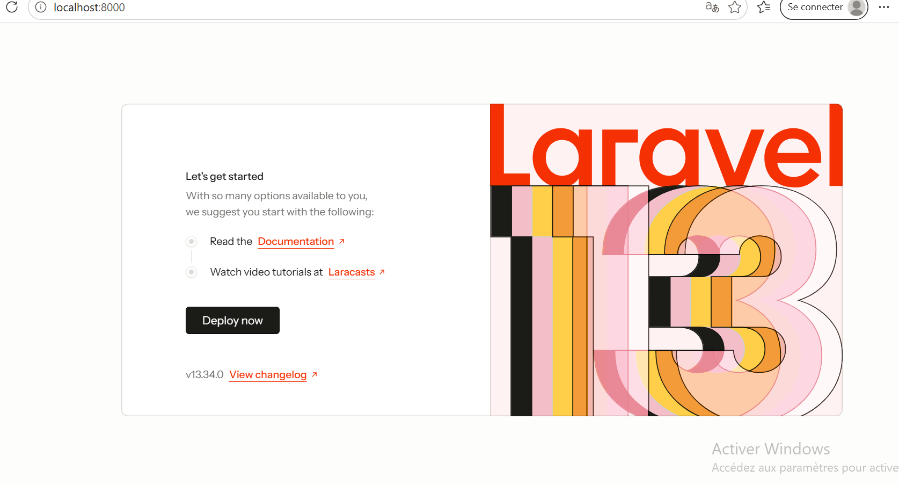

### Liste des routes

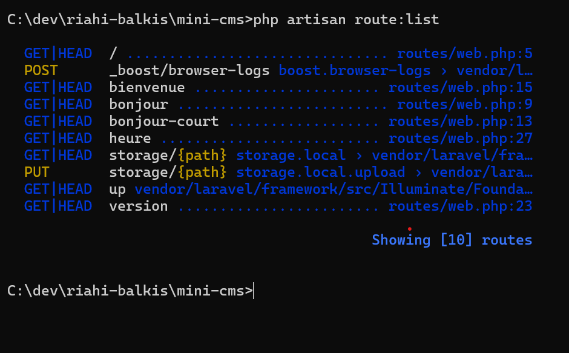

### Page À propos

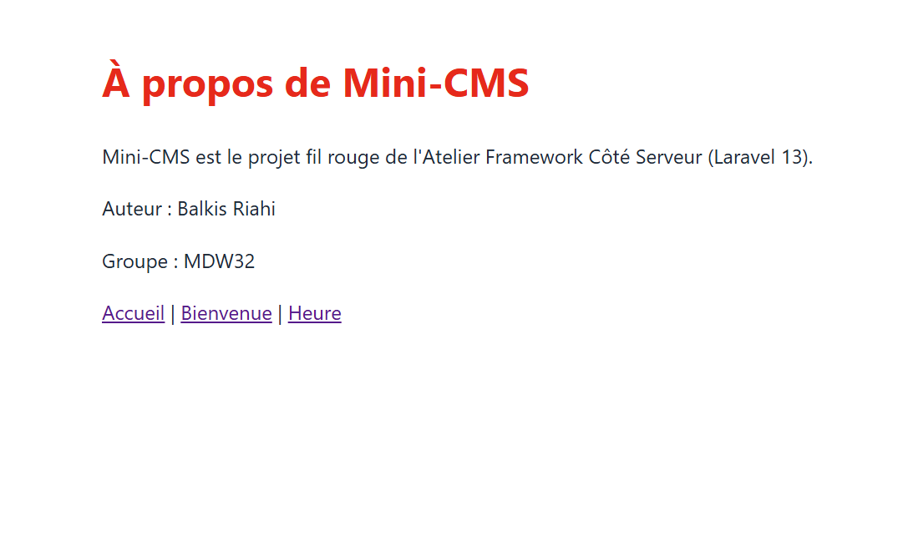

### Accueil avec le layout

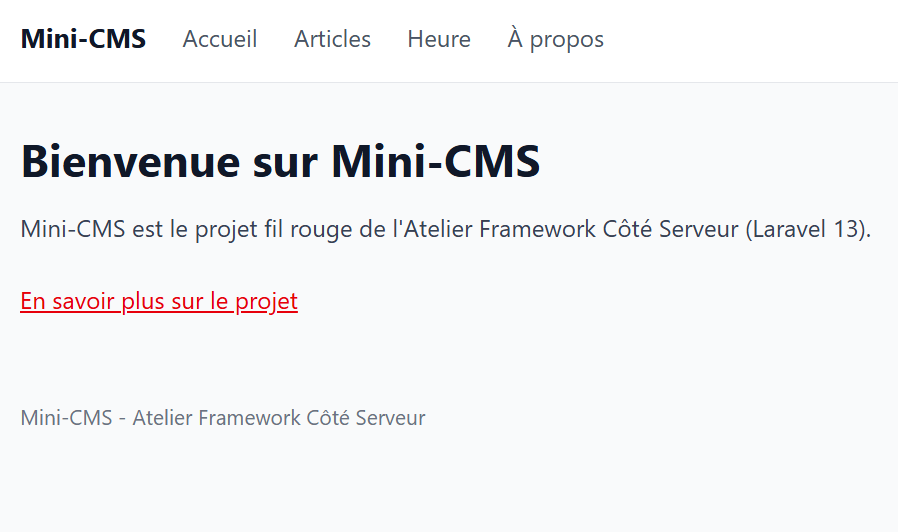

### Liste des articles — Session 03

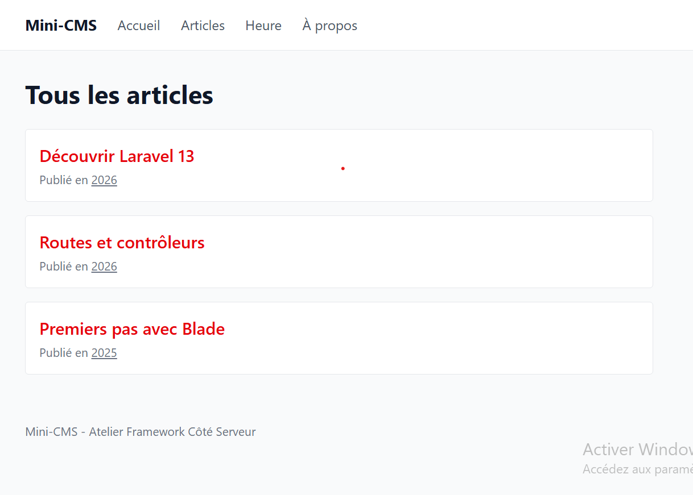

### Détail d'un article

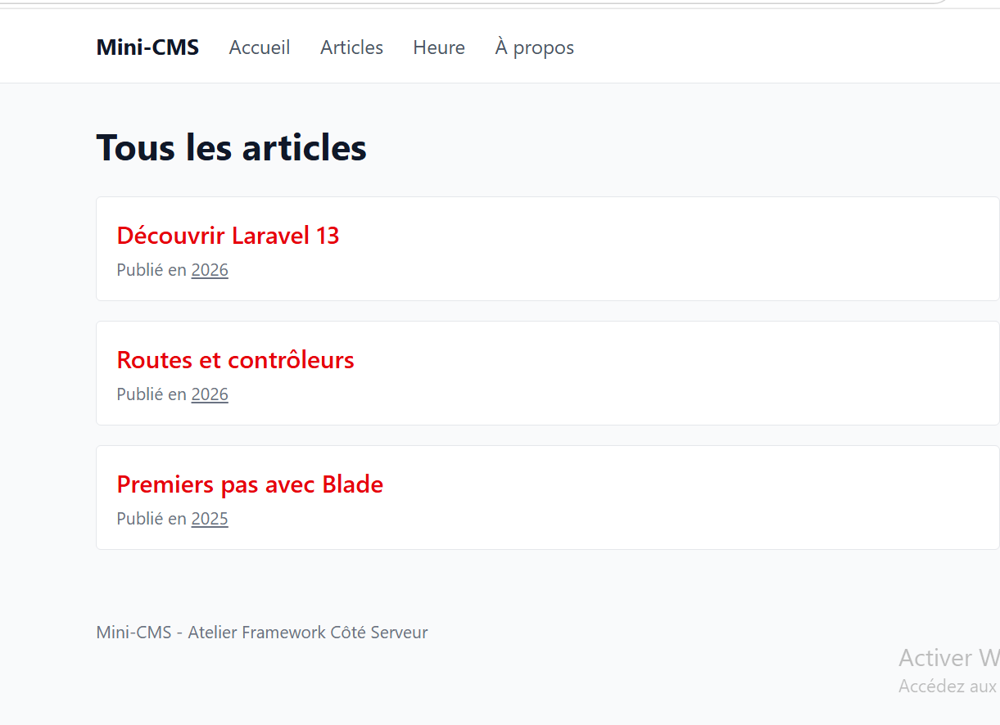

### Session 04

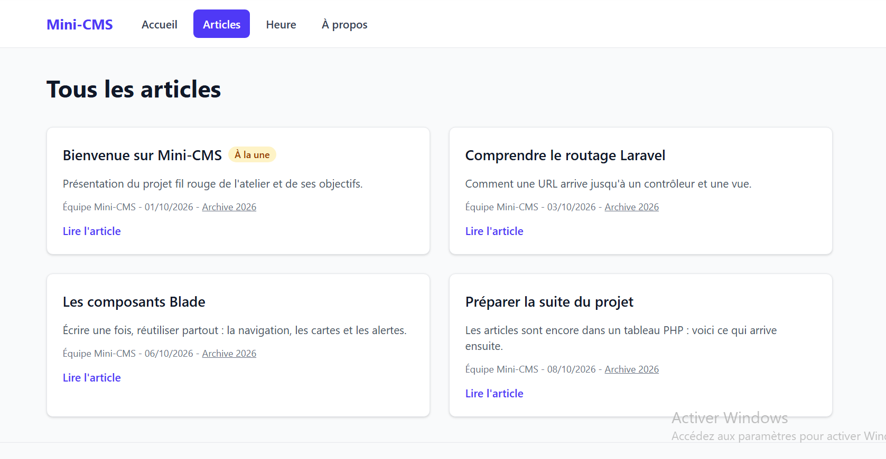

### Session 06

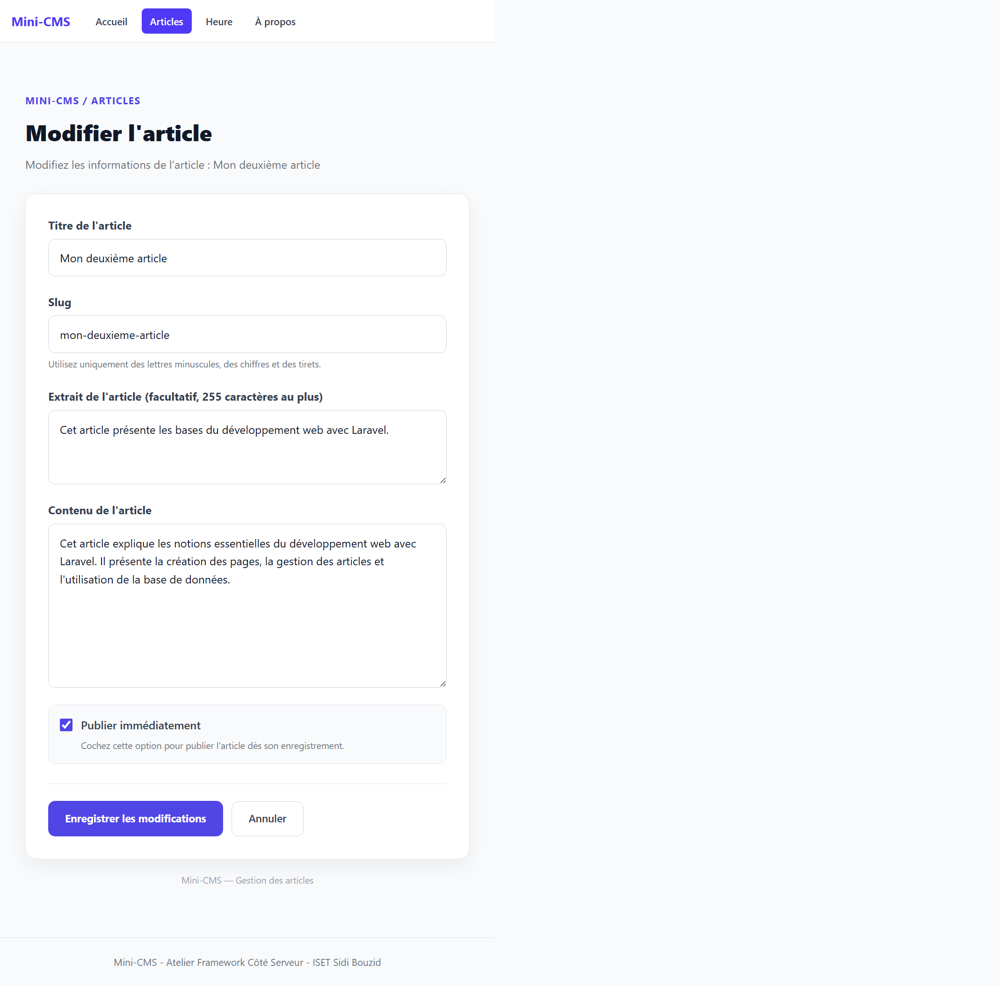

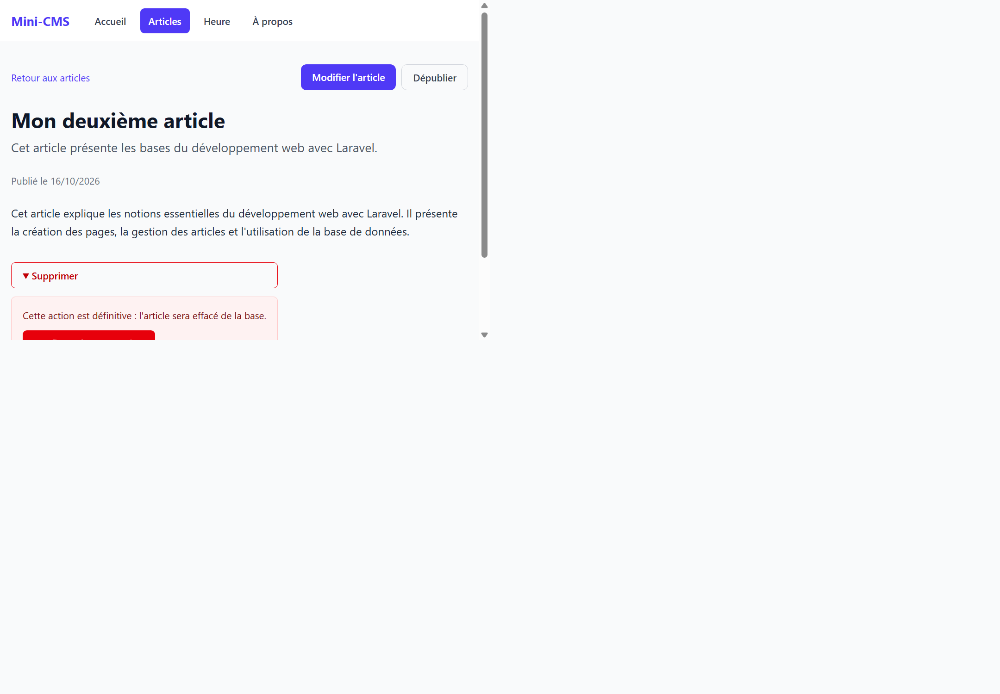

### Session 07

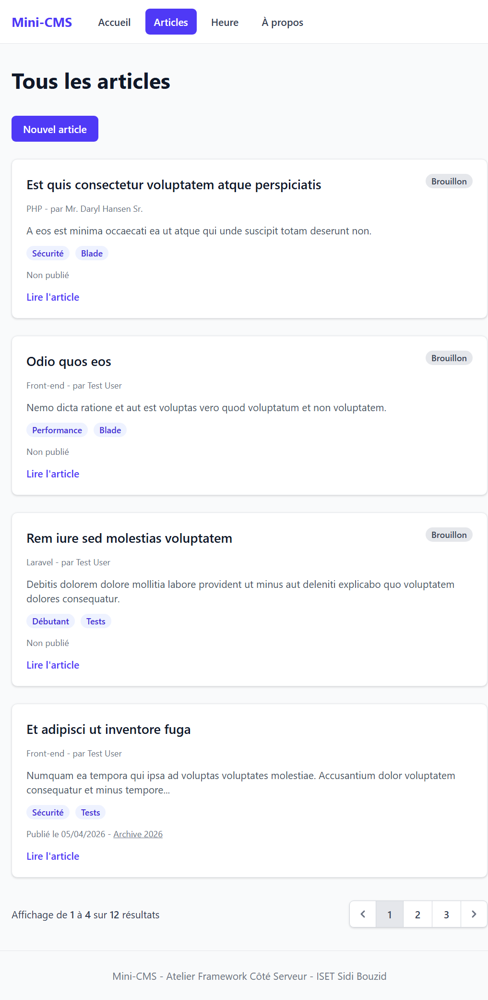

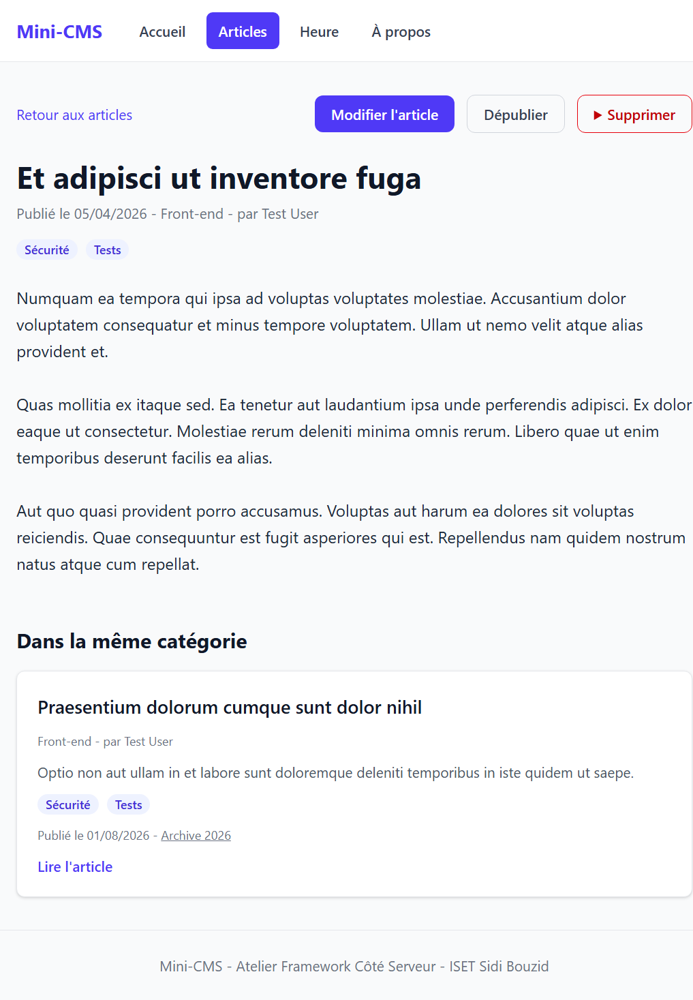

### Session 08

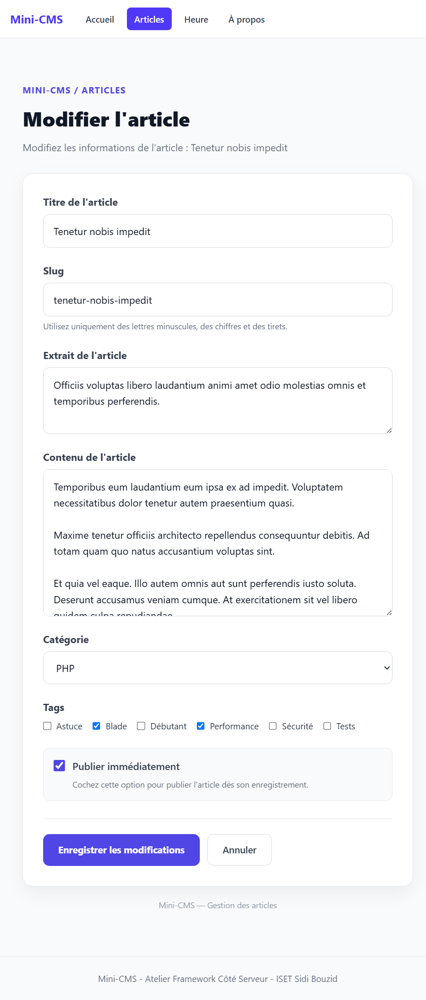

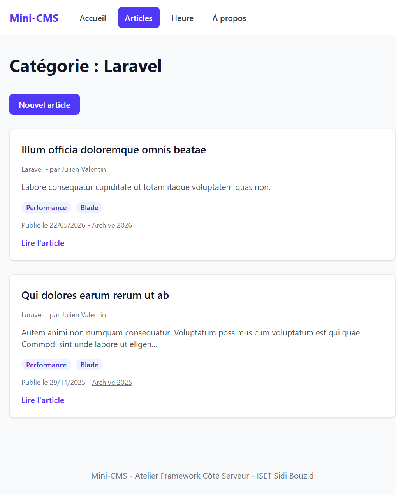