# Mini-CMS

Projet fil rouge de l'Atelier Framework Côté Serveur (Laravel 13, PHP 8.3+), 3e année MDW, ISET Sidi Bouzid.

Auteur : Balkis Riahi, groupe MDW33.

## Description

Mini-CMS est une petite plateforme de publication construite au fil du semestre : un site public qui présente les articles publiés, un back-office authentifié pour les écrire, et une API JSON pour les lire et les modifier depuis un autre client. Le projet utilise Laravel 13, Blade, SQLite et Pest, sans starter kit : l'authentification, les rôles, les Policies et les Resources sont écrits à la main.

## Fonctionnalités

- Site public : liste des articles publiés, détail d'un article, articles d'une catégorie, articles d'un tag, archives par année, pagination, page À propos et page de l'heure.
- Authentification : inscription, connexion, déconnexion, rôles `admin` et `author`.
- Back-office : création, modification et suppression des articles ; gestion des catégories, des tags et des rôles ; publication et dépublication d'un article.
- Autorisations : Gates et Policies ; un brouillon n'est visible que par son auteur ou un administrateur, et la zone `/admin` est réservée aux administrateurs.
- API JSON : lecture publique des articles, catégories et tags ; écritures protégées par des jetons Sanctum ; filtres `?category=` et `?tag=`.
- Validation en français, Form Requests, API Resources, chargement anticipé et pages d'erreur 404 et 503.
- Tests Pest : site, back-office, autorisations et API.

### Routes disponibles

| Méthode | URI | Nom | Action |
|---|---|---|---|
| GET | `/` | `home` | `PageController@home` |
| GET | `/a-propos` | `about` | `PageController@about` |
| GET | `/heure` | `time` | `PageController@time` |
| GET | `/inscription` | `register` | `RegisterController@create` |
| POST | `/inscription` | - | `RegisterController@store` |
| GET | `/connexion` | `login` | `LoginController@create` |
| POST | `/connexion` | - | `LoginController@store` |
| POST | `/deconnexion` | `logout` | `LoginController@destroy` |
| GET | `/posts` | `posts.index` | `PostController@index` |
| GET | `/posts/archive/{year}` | `posts.archive` | `PostController@archive` |
| GET | `/posts/categorie/{category:slug}` | `posts.category` | `PostController@byCategory` |
| GET | `/posts/tag/{tag:slug}` | `posts.tag` | `PostController@byTag` |
| GET | `/posts/create` | `posts.create` | `PostController@create` |
| POST | `/posts` | `posts.store` | `PostController@store` |
| GET | `/posts/{post}` | `posts.show` | `PostController@show` |
| GET | `/posts/{post}/edit` | `posts.edit` | `PostController@edit` |
| PUT/PATCH | `/posts/{post}` | `posts.update` | `PostController@update` |
| DELETE | `/posts/{post}` | `posts.destroy` | `PostController@destroy` |
| PATCH | `/posts/{post}/publication` | `posts.publication` | `PostController@togglePublication` |
| GET | `/mes-articles` | `posts.mine` | `PostController@myPosts` |
| GET | `/admin/categories` | `admin.categories.index` | `CategoryController@index` |
| GET | `/admin/categories/create` | `admin.categories.create` | `CategoryController@create` |
| POST | `/admin/categories` | `admin.categories.store` | `CategoryController@store` |
| GET | `/admin/categories/{category}/edit` | `admin.categories.edit` | `CategoryController@edit` |
| PUT/PATCH | `/admin/categories/{category}` | `admin.categories.update` | `CategoryController@update` |
| DELETE | `/admin/categories/{category}` | `admin.categories.destroy` | `CategoryController@destroy` |
| GET | `/admin/tags` | `admin.tags.index` | `TagController@index` |
| GET | `/admin/tags/create` | `admin.tags.create` | `TagController@create` |
| POST | `/admin/tags` | `admin.tags.store` | `TagController@store` |
| GET | `/admin/tags/{tag}/edit` | `admin.tags.edit` | `TagController@edit` |
| PUT/PATCH | `/admin/tags/{tag}` | `admin.tags.update` | `TagController@update` |
| DELETE | `/admin/tags/{tag}` | `admin.tags.destroy` | `TagController@destroy` |
| GET | `/admin/utilisateurs` | `admin.users.index` | `UserRoleController@index` |
| PATCH | `/admin/utilisateurs/{user}/role` | `admin.users.role` | `UserRoleController@updateRole` |
| GET | `/api/posts` | `api.posts.index` | `Api\PostController@index` |
| GET | `/api/posts/{post}` | `api.posts.show` | `Api\PostController@show` |
| GET | `/api/categories` | `api.categories.index` | `Api\CategoryController@index` |
| GET | `/api/categories/{category}` | `api.categories.show` | `Api\CategoryController@show` |
| GET | `/api/tags` | `api.tags.index` | `Api\TagController@index` |
| GET | `/api/tags/{tag}` | `api.tags.show` | `Api\TagController@show` |
| POST | `/api/login` | `api.login` | `Api\AuthController@login` |
| POST | `/api/logout` | `api.logout` | `Api\AuthController@logout` |
| POST | `/api/posts` | `api.posts.store` | `Api\PostController@store` |
| PUT/PATCH | `/api/posts/{post}` | `api.posts.update` | `Api\PostController@update` |
| DELETE | `/api/posts/{post}` | `api.posts.destroy` | `Api\PostController@destroy` |

## Installation

Le projet fonctionne avec SQLite : aucun serveur de base de données n'est nécessaire.

### Bash (Git Bash, macOS, Linux)

```bash
git clone https://github.com/BALKIS1429/mini-cms.git
cd mini-cms
composer install
npm install
npm run build
cp .env.example .env
php artisan key:generate
touch database/database.sqlite
php artisan migrate:fresh --seed
php artisan test
composer run dev
```

### PowerShell (Windows)

```powershell
git clone https://github.com/BALKIS1429/mini-cms.git
cd mini-cms
composer install
npm install
npm run build
copy .env.example .env
php artisan key:generate
New-Item -ItemType File database\database.sqlite
php artisan migrate:fresh --seed
php artisan test
composer run dev
```

`composer run dev` lance le serveur PHP, Vite et la file d'attente. Ouvrir ensuite [http://localhost:8000](http://localhost:8000).

`npm run build` est obligatoire avant `php artisan test` : le layout charge ses fichiers avec `@vite`, et les tests qui affichent une page échouent si le manifeste n'existe pas.

## Comptes de test

Le seeder crée les comptes suivants. Tous les mots de passe valent `password`.

| Rôle | E-mail | Mot de passe |
|---|---|---|
| Administrateur | `test@example.com` | `password` |
| Auteur 1 | e-mail aléatoire généré par la fabrique | `password` |
| Auteur 2 | e-mail aléatoire généré par la fabrique | `password` |

Pour retrouver l'e-mail d'un auteur :

```bash
php artisan tinker --execute="echo App\Models\User::where('role', 'author')->value('email');"
```

## API

### Endpoints

| Méthode | URI | Accès | Rôle |
|---|---|---|---|
| GET | `/api/posts` | public | liste paginée des articles publiés, filtres `?category=<slug>`, `?tag=<slug>` et `?per_page=` |
| GET | `/api/posts/{post}` | public | un article ; un brouillon exige son auteur ou un administrateur |
| POST | `/api/posts` | jeton | créer un article |
| PUT/PATCH | `/api/posts/{post}` | jeton | modifier son propre article |
| DELETE | `/api/posts/{post}` | jeton | supprimer son propre article |
| GET | `/api/categories` | public | catégories avec leur nombre d'articles publiés |
| GET | `/api/categories/{category}` | public | une catégorie avec son nombre d'articles publiés |
| GET | `/api/tags` | public | tags avec leur nombre d'articles publiés |
| GET | `/api/tags/{tag}` | public | un tag avec son nombre d'articles publiés |
| POST | `/api/login` | public | connexion, renvoie un jeton |
| POST | `/api/logout` | jeton | révoque le jeton de la requête |

Les listes et les détails renvoient une clé `data`. Les listes d'articles sont paginées et ajoutent `links` et `meta`.

### Authentification par jeton

L'API ne garde pas de session : chaque requête protégée présente un jeton dans l'en-tête `Authorization: Bearer <jeton>`.

1. Se connecter avec `POST /api/login` et un corps JSON `{"email": "...", "password": "..."}`. La réponse `201` contient un `token`, affiché une seule fois.
2. Envoyer ce jeton dans l'en-tête `Authorization` de chaque requête protégée.
3. Se déconnecter avec `POST /api/logout` : le jeton courant est supprimé et ne fonctionne plus.

```bash
curl.exe -X POST -H "Accept: application/json" -H "Content-Type: application/json" \
  -d "{\"email\":\"test@example.com\",\"password\":\"password\"}" \
  http://localhost:8000/api/login
```

### Codes d'erreur

| Code | Cas | Corps |
|---|---|---|
| `401` | aucun jeton, jeton inconnu ou révoqué | `{"message": "Unauthenticated."}` |
| `403` | jeton valide mais action interdite par la Policy (article d'un autre auteur) | `{"message": "This action is unauthorized."}` |
| `404` | article, catégorie ou tag inexistant | `{"message": "No query results for model [...]"}` |
| `422` | données invalides, identifiants incorrects ou slug inconnu dans un filtre | `{"message": "...", "errors": {...}}` |

En local, les réponses `403`, `404` et `422` ajoutent `exception`, `file`, `line` et `trace`. L'ordre des contrôles est : authentification (`401`), liaison du modèle (`404`), autorisation (`403`), validation (`422`).

### Exemple curl.exe

```bash
curl.exe -X POST -H "Accept: application/json" -H "Authorization: Bearer VOTRE_JETON" http://localhost:8000/api/logout
```

La réponse `204 No Content` n'a pas de corps. Remplacer `VOTRE_JETON` par un jeton obtenu avec `POST /api/login` ; ne jamais enregistrer un vrai jeton dans ce fichier.

Autre exemple, en lecture :

```bash
curl.exe -H "Accept: application/json" http://localhost:8000/api/posts?per_page=2
```

## Captures d'écran

### Page d'accueil

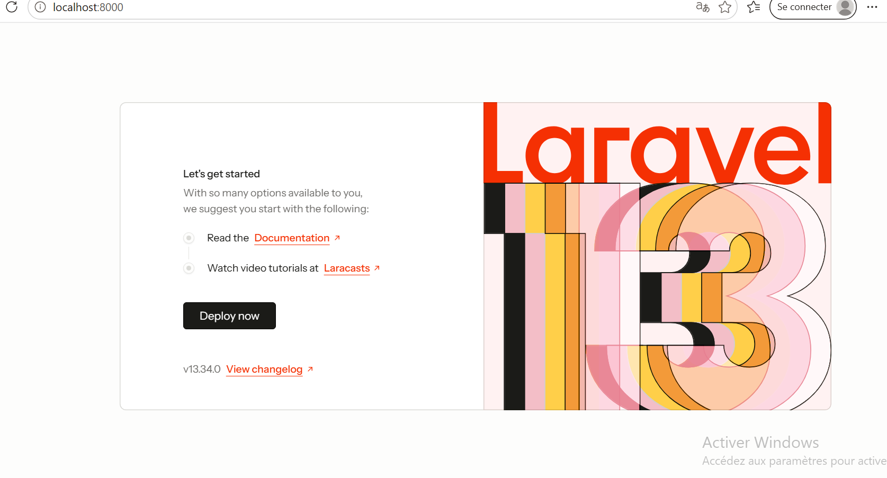

### Liste des routes


### Page À propos

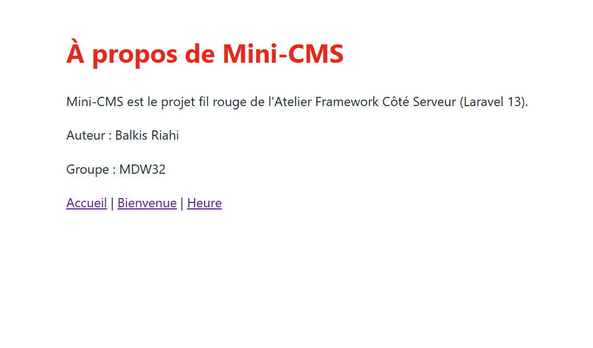

### Accueil avec le layout

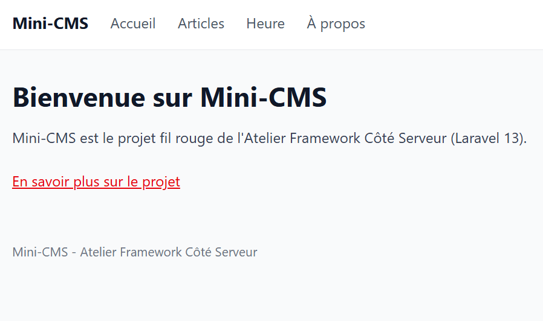

### Liste des articles — Session 03


### Détail d'un article


### Session 04

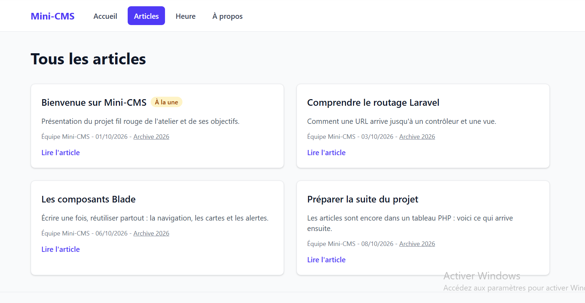

### Session 06

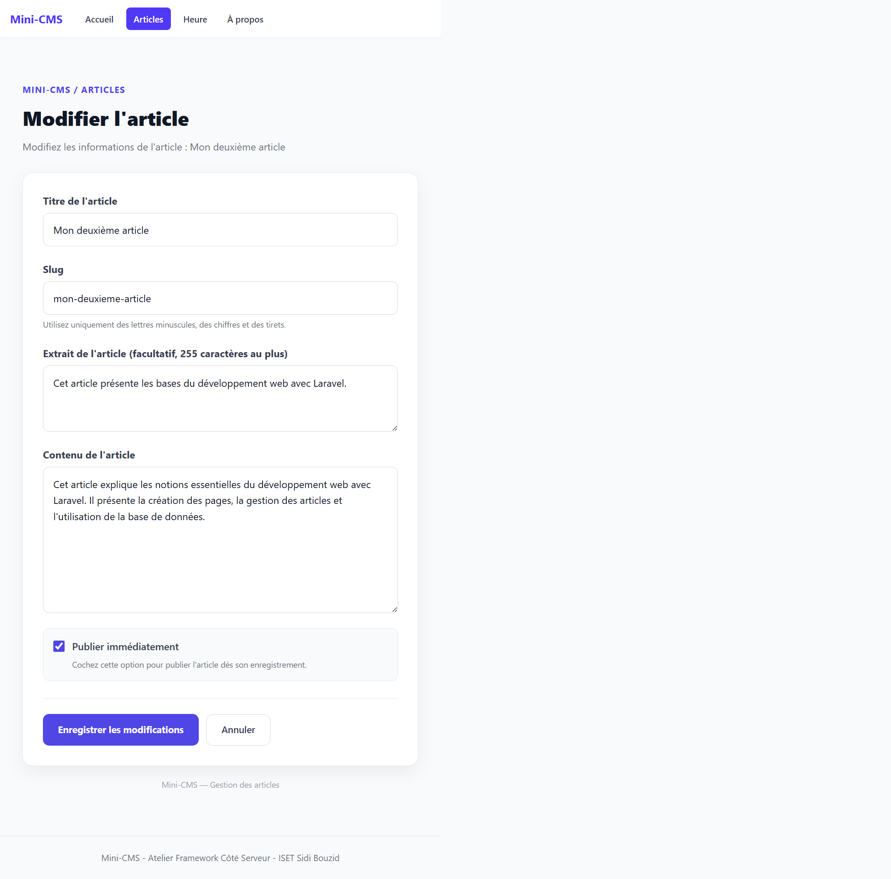


### Session 07


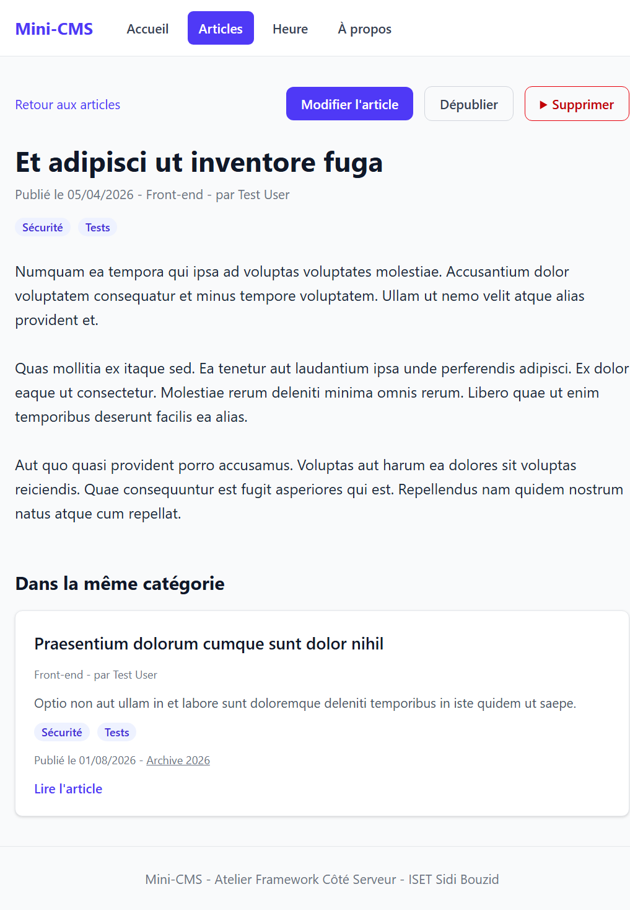

### Session 08


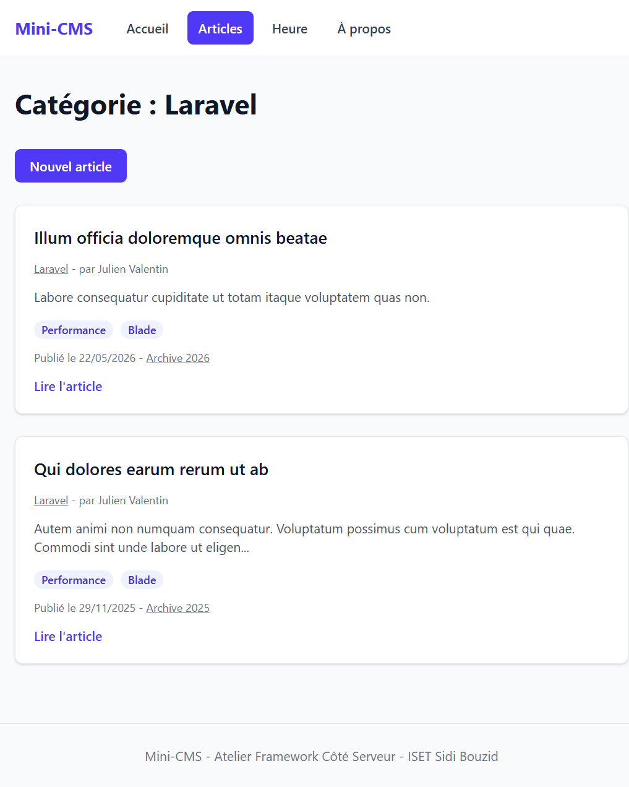

### Session 09

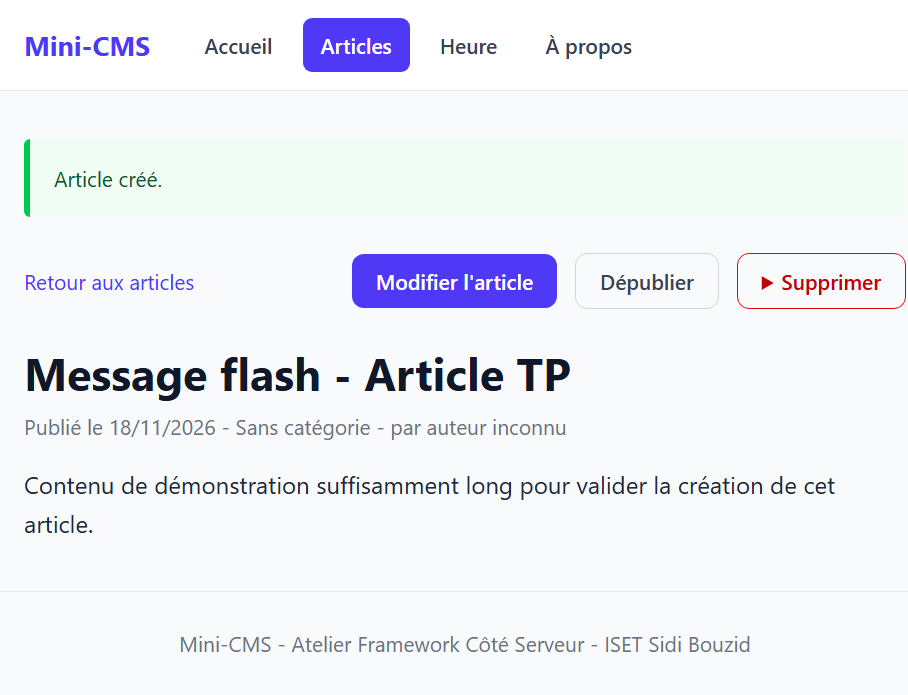

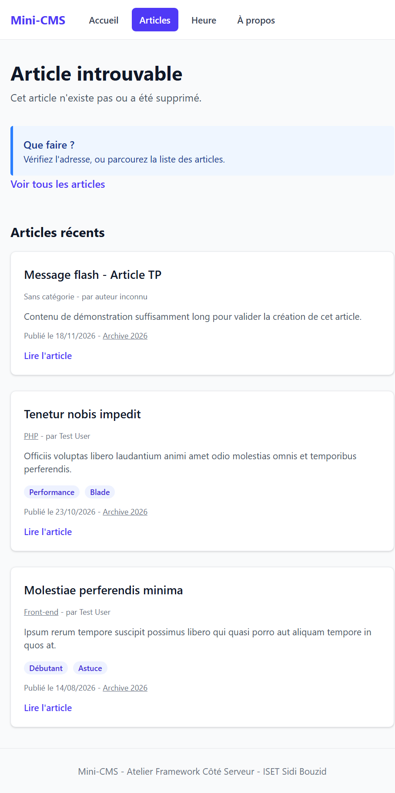

### Session 10

Back-office des catégories et des tags, messages de validation en français, pages 404 et 503 dans le layout du site.

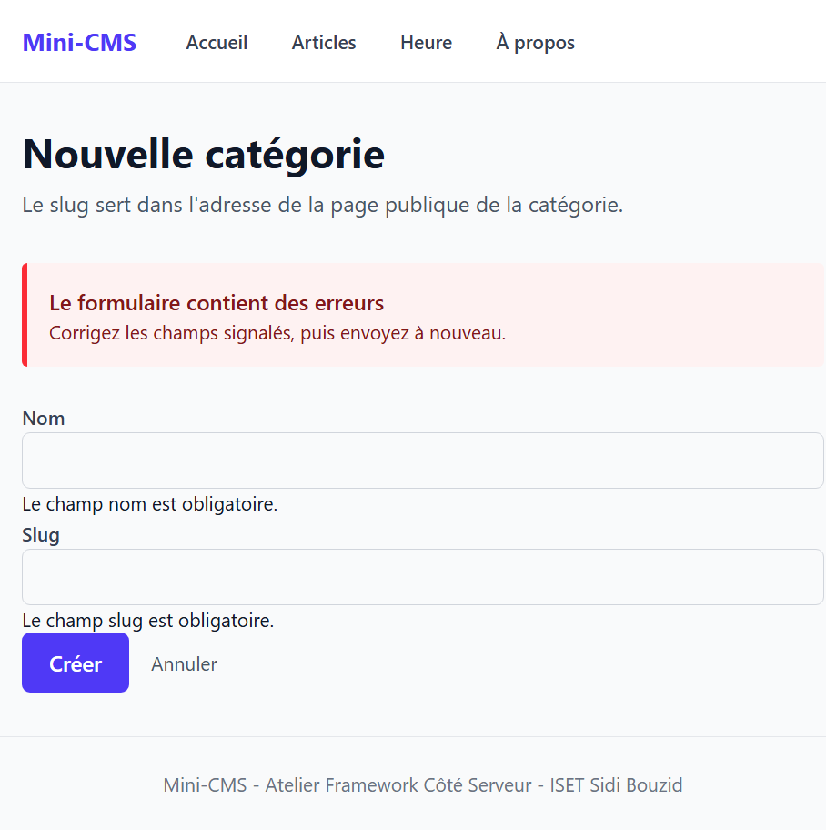


### Session 11

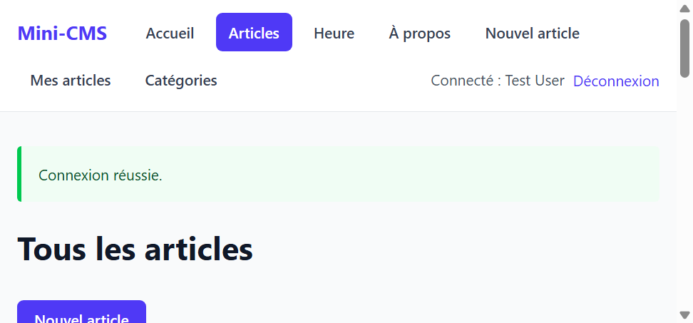


### Session 12


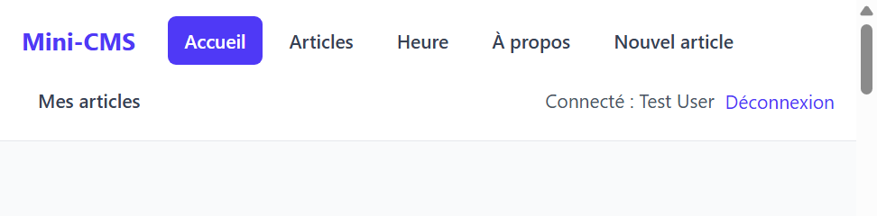

### Session 13

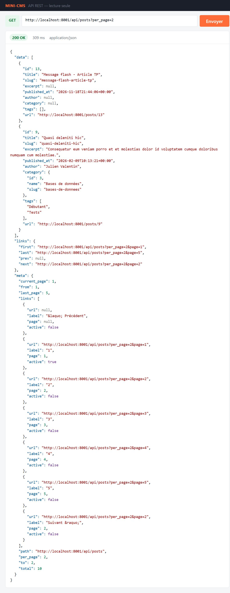

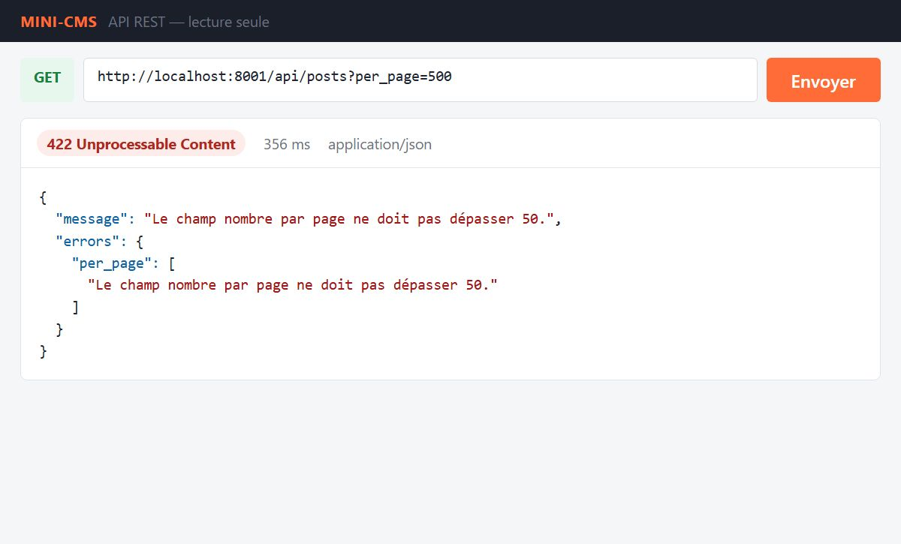

## Choix d'architecture

### Pourquoi les écritures de l'API passent par PostPolicy

Le site et l'API écrivent dans les mêmes tables avec les mêmes règles : un article appartient à son auteur, un brouillon n'est visible que par son auteur ou un administrateur, et seul le propriétaire peut modifier ou supprimer son article. Écrire ces règles une seconde fois dans `Api\PostController` aurait créé deux vérités à maintenir : le jour où la règle change sur le site, l'API serait restée permissive sans que personne ne le voie. En réutilisant `PostPolicy`, l'API hérite automatiquement de la règle du site, et l'autorisation reste à un seul endroit. C'est aussi ce qui donne l'ordre correct des réponses : la Policy est vérifiée dans `authorize()` de la Form Request et avant `rules()`, donc un auteur qui modifie l'article d'un autre reçoit `403` même si le corps est invalide, au lieu d'un `422` qui ne dirait rien de ses droits.

### Pourquoi preventLazyLoading est activé

`Model::preventLazyLoading(! app()->isProduction())` transforme en erreur visible, en développement, chaque relation lue sans avoir été chargée avec `with()` ou `withCount()`. Sans ce garde-fou, une liste de vingt articles déclencherait une requête SQL par article pour son auteur et sa catégorie : la page resterait correcte, mais le nombre de requêtes augmenterait avec le nombre d'articles, jusqu'à devenir lent en production. L'erreur en développement oblige donc à écrire le chargement anticipé au bon endroit, dans le contrôleur, au lieu de le découvrir en production sous la forme d'un problème de performance difficile à relier au code. La condition `! app()->isProduction()` évite de casser une page en production si un oubli subsiste.

### Pourquoi l'API utilise des jetons et non la session

Le groupe de routes `api` n'a ni session ni cookie : il ne se souvient de personne entre deux requêtes. Un client mobile, Postman ou une autre application ne peut donc pas « rester connecté » comme un navigateur ; il présente une preuve d'identité à chaque appel. Sanctum fournit cette preuve sous forme de jeton : `POST /api/login` en crée un, `POST /api/logout` le supprime. Ce choix évite aussi le CSRF, puisque le navigateur n'envoie jamais le jeton tout seul, contrairement à un cookie de session. Enfin, un jeton est révocable individuellement : perdre son téléphone ne déconnecte pas la session du navigateur, et la base ne conserve que l'empreinte SHA-256 du jeton, ce qui limite les dégâts si elle est volée.

## Comparaison avec le starter kit Livewire

| Fonction | Mini-CMS (authentification manuelle) | Starter kit Livewire |
|---|---|---|
| Routes d'authentification | `/inscription`, `/connexion` et `/deconnexion` sont déclarées dans `routes/web.php`. | Fortify enregistre les routes depuis son paquet ; elles ne sont pas déclarées dans `routes/web.php`. |
| Inscription | `RegisterController`, `RegisterRequest` et `Hash::make`. | `app/Actions/Fortify/CreateNewUser.php` valide puis crée l'utilisateur ; écran Livewire dans `resources/views/pages/auth/register.blade.php`. |
| Connexion | `LoginController::store` appelle `Auth::attempt`, puis régénère la session. | Contrôleur Fortify et `resources/views/pages/auth/login.blade.php`. |
| Déconnexion | `LoginController::destroy` appelle `Auth::logout`, `invalidate()` et `regenerateToken()`. | Route Fortify et `app/Livewire/Actions/Logout.php` effectuent ces opérations. |
| Limitation des tentatives | Aucune limitation n'est configurée dans Mini-CMS. | Cinq tentatives par minute et par e-mail/adresse IP via `FortifyServiceProvider`. |
| Mot de passe oublié | Non implémenté. | `Features::resetPasswords()` dans `config/fortify.php`. |
| Vérification de l'e-mail | Non implémentée. | `Features::emailVerification()`, `MustVerifyEmail` et le middleware `verified`. |
| Double authentification | Non implémentée. | `Features::twoFactorAuthentication()` et `Features::passkeys()`. |
| Rôles et autorisations | Rôle `role`, middleware `admin`, Gates et Policies adaptés au CMS. | Les autorisations propres au domaine restent à écrire. |
| Tests | `AuthTest`, `AuthorizationTest`, `AdminAccessTest`, `PostVisibilityTest`, `UserRoleTest` et les autres tests Pest de l'application. | Dix fichiers `tests/Feature` (Auth, Settings, Dashboard), écrits avec PHPUnit dans le dépôt du kit. |

Dans un vrai projet, je garderais du kit la limitation des tentatives, la réinitialisation du mot de passe, la vérification de l'e-mail et le double facteur, pour éviter de réinventer ces protections. Je conserverais les Gates, Policies et le middleware propres à l'application, car aucun starter kit ne connaît les rôles métier de Mini-CMS.
